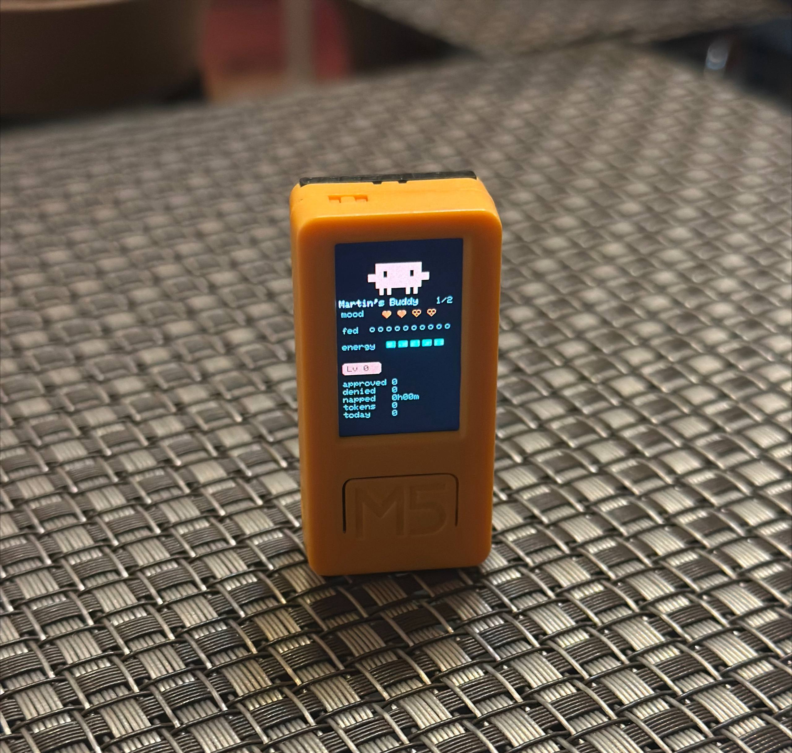

# claude-desktop-buddy for M5StickC Plus2

> **This is a fork of
> [anthropics/claude-desktop-buddy](https://github.com/anthropics/claude-desktop-buddy)
> ported to the M5StickC Plus2** by [@Martin78b](https://github.com/Martin78b)
> ([repo](https://github.com/Martin78b/claude-desktop-buddy-plus2)). The upstream firmware targets the original
> M5StickC Plus and the `M5StickCPlus` library (AXP192 power chip). The Plus2
> has no AXP192, so this fork moves everything to
> [`M5Unified`](https://github.com/m5stack/M5Unified) behind a small
> hardware layer in `src/hal.h`.
>
> **What's different from upstream**
>
> - Runs on the **M5StickC Plus2** (ESP32-PICO-V3-02, 8MB flash). It does not
>   target the original Plus anymore; use upstream for that board.
> - 8MB partition table (`partitions_plus2_8MB.csv`): 3MB app + ~4.9MB
>   LittleFS for character packs.
> - A 19th pet, **Clawd**: the orange critter from Claude Code, drawn as
>   pixel art with all seven animations.
> - The settings menu shows the current pet's name while you cycle pets.
>
> **Plus2 limitations:** no battery-current or VBUS measurement (USB power
> is inferred from battery voltage ≥ 4.15V), and "turn off" from the menu
> only works on battery, because USB keeps the board powered.


Claude for macOS and Windows can connect Claude Cowork and Claude Code to
maker devices over BLE, so developers and makers can build hardware that
displays permission prompts, recent messages, and other interactions. We've
been impressed by the creativity of the maker community around Claude -
providing a lightweight, opt-in API is our way of making it easier to build
fun little hardware devices that integrate with Claude.

> **Building your own device?** You don't need any of the code here. See
> **[REFERENCE.md](REFERENCE.md)** for the wire protocol: Nordic UART
> Service UUIDs, JSON schemas, and the folder push transport.

As an example, we built a desk pet on ESP32 that lives off permission
approvals and interaction with Claude. It sleeps when nothing's happening,
wakes when sessions start, gets visibly impatient when an approval prompt is
waiting, and lets you approve or deny right from the device.

<p align="center">
  
</p>

<p align="center">
  
  <br><em>This port running on an M5StickC Plus2, with the Clawd pet.</em>
</p>

## Hardware

This fork targets the **M5StickC Plus2** with the Arduino framework and
[`M5Unified`](https://github.com/m5stack/M5Unified) for the display, IMU,
buttons, RTC, buzzer and power management. Board-specific code lives in
`src/hal.h`:

| | M5StickC Plus (upstream) | M5StickC Plus2 (this fork) |
| --- | --- | --- |
| Library | `M5StickCPlus` | `M5Unified` |
| Power chip | AXP192 | none (GPIO4 power hold) |
| Backlight | AXP LDO2 | PWM via M5GFX |
| Red LED | GPIO10, active-low | GPIO19, active-high |
| Flash | 4MB | 8MB |
| Battery current / VBUS | measured | not available |

For the original M5StickC Plus, use
[upstream](https://github.com/anthropics/claude-desktop-buddy).

## Flashing

Install
[PlatformIO Core](https://docs.platformio.org/en/latest/core/installation/),
connect the Plus2 over USB-C, then:

```bash
pio run -e m5stickc-plus2 -t upload
```

If more than one serial port is present, pass it explicitly, for example
`--upload-port /dev/cu.usbserial-XXXX` (`ls /dev/cu.*` on macOS).

If you're starting from a previously-flashed device, wipe it first:

```bash
pio run -t erase && pio run -t upload
```

Once running, you can also wipe everything from the device itself: **hold A
→ settings → reset → factory reset → tap twice**.

## Pairing

To pair your device with Claude, first enable developer mode (**Help →
Troubleshooting → Enable Developer Mode**). Then, open the Hardware Buddy
window in **Developer → Open Hardware Buddy…**, click **Connect**, and pick
your device from the list. macOS will prompt for Bluetooth permission on
first connect; grant it.

<p align="center">
  
  
</p>

Once paired, the bridge auto-reconnects whenever both sides are awake.

If discovery isn't finding the stick:

- Make sure it's awake (any button press)
- Check the stick's settings menu → bluetooth is on

## Controls

|                         | Normal               | Pet         | Info        | Approval    |
| ----------------------- | -------------------- | ----------- | ----------- | ----------- |
| **A** (front)           | next screen          | next screen | next screen | **approve** |
| **B** (right)           | scroll transcript    | next page   | next page   | **deny**    |
| **Hold A**              | menu                 | menu        | menu        | menu        |
| **Power** (left, short) | toggle screen off    |             |             |             |
| **Power** (left, ~6s)   | hard power off       |             |             |             |
| **Shake**               | dizzy                |             |             | —           |
| **Face-down**           | nap (energy refills) |             |             |             |

The screen auto-powers-off after 30s of no interaction (kept on while an
approval prompt is up). Any button press wakes it.

## ASCII pets

Nineteen pets, each with seven animations (sleep, idle, busy, attention,
celebrate, dizzy, heart): capybara, duck, goose, blob, cat, dragon, octopus,
owl, penguin, turtle, snail, ghost, axolotl, cactus, robot, rabbit, mushroom,
chonk and **clawd**. **Hold A → settings → pet row** cycles them; the row
shows the pet's name and a counter. Choice persists to NVS.

Clawd (`src/buddies/clawd.cpp`) is pixel art rather than ASCII. It is drawn
with `buddyFillPx()`, which scales and positions like the ASCII helpers, so
it's a template if you want to add other pixel-art pets.

**ID** is the index stored in NVS (`SPECIES_TABLE` in `src/buddy.cpp`);
**Menu** is the counter shown in the settings pet row; **Color** is the
body color as the display renders it (RGB565, so slightly quantized). When a GIF character
is installed it is added as one extra entry after the last pet. Previews are
generated from the sprite tables in `src/buddies/`.

### At a glance (idle)

```
 1 capybara        2 duck            3 goose           4 blob
    n______n           __                (>               .--.
   ( o    o )        <(o )___            ||              (o  o)
   (   oo   )         (  ._>           _(__)_            (    )
    `------'           `--´             ^^^^              `--`

 5 cat             6 dragon          7 octopus         8 owl
    /\_/\             /^\  /^\          .----.            /\  /\
   ( o   o )         <  o    o >       ( o  o )          ((O)(O))
   (  w   )          (   ww   )        (______)          (  ><  )
   (")_(")            `-vvvv-'         /\/\/\/\           `----'

 9 penguin        10 turtle         11 snail          12 ghost
     .---.             _,--._           \\  /             .----.
    ( o>o )           ( o    o)           .--.           ( o    o )
   /(     )\         /[______]\         _( oo )_         |   __   |
    `-----`           ``    ``         (___@@___)        ~`~``~`~
     J   L                              ~~~~~~~~

13 axolotl        14 cactus         15 robot          16 rabbit
   }~(______)~{      n  ____  n         .[||].             (\_/)
   }~( o  o )~{      | |o  o| |        [ o    o ]         ( o o )
     ( .--. )        |_|    |_|        [ ==== ]          =(  v  )=
     (_/  \_)          |    |          `------'           (")_(")

17 mushroom       18 chonk          19 clawd
    .-o-OO-o-.        /\____/\           ████████████
   (__________)      ( o    o )        ▄▄██ ██████ ██▄▄
      |o   o|        (   ..   )        ▀▀████████████▀▀
      |____|          `------'           ▀█▀█▀▀▀▀█▀█▀
                                          ▀ ▀    ▀ ▀
```

| ID | Menu | Name | Color | Source |
| -- | ---- | ---- | ----- | ------ |
| 0 | 1/19 | **capybara** | `#C55531` | [`capybara.cpp`](src/buddies/capybara.cpp) |
| 1 | 2/19 | **duck** | `#FFFF00` | [`duck.cpp`](src/buddies/duck.cpp) |
| 2 | 3/19 | **goose** | `#FFFFFF` | [`goose.cpp`](src/buddies/goose.cpp) |
| 3 | 4/19 | **blob** | `#00FF83` | [`blob.cpp`](src/buddies/blob.cpp) |
| 4 | 5/19 | **cat** | `#C55531` | [`cat.cpp`](src/buddies/cat.cpp) |
| 5 | 6/19 | **dragon** | `#FF0000` | [`dragon.cpp`](src/buddies/dragon.cpp) |
| 6 | 7/19 | **octopus** | `#A400FF` | [`octopus.cpp`](src/buddies/octopus.cpp) |
| 7 | 8/19 | **owl** | `#838583` | [`owl.cpp`](src/buddies/owl.cpp) |
| 8 | 9/19 | **penguin** | `#0081FF` | [`penguin.cpp`](src/buddies/penguin.cpp) |
| 9 | 10/19 | **turtle** | `#00FF00` | [`turtle.cpp`](src/buddies/turtle.cpp) |
| 10 | 11/19 | **snail** | `#DE1CF6` | [`snail.cpp`](src/buddies/snail.cpp) |
| 11 | 12/19 | **ghost** | `#FFFFFF` | [`ghost.cpp`](src/buddies/ghost.cpp) |
| 12 | 13/19 | **axolotl** | `#FF61F6` | [`axolotl.cpp`](src/buddies/axolotl.cpp) |
| 13 | 14/19 | **cactus** | `#00FF00` | [`cactus.cpp`](src/buddies/cactus.cpp) |
| 14 | 15/19 | **robot** | `#C5C2C5` | [`robot.cpp`](src/buddies/robot.cpp) |
| 15 | 16/19 | **rabbit** | `#FFFFFF` | [`rabbit.cpp`](src/buddies/rabbit.cpp) |
| 16 | 17/19 | **mushroom** | `#FF0083` | [`mushroom.cpp`](src/buddies/mushroom.cpp) |
| 17 | 18/19 | **chonk** | `#FFA500` | [`chonk.cpp`](src/buddies/chonk.cpp) |
| 18 | 19/19 | **clawd** | `#DE7552` | [`clawd.cpp`](src/buddies/clawd.cpp) |

Clawd is pixel art on the device (orange `#D97757` rects drawn with
`buddyFillPx()`); here it's rendered with block characters at one block per
4px cell, so fine details like heart eyes are simplified.

### All seven states per pet

First frame of each state (particles such as `z`, `!`, hearts and confetti are drawn on top and not shown).

<details>
<summary><b>capybara</b> · ID 0 · menu 1/19 · <code>#C55531</code></summary>

```
sleep         idle          busy          attention
    .--.        n______n      n______n        ^  ^
  _( -- )_     ( o    o )    ( v    v )    /^_____^\
 (___zz___)    (   oo   )    (   --   )   ( O      O )
                `------'     /`------'\    (   O    )
                                            `------'

celebrate     dizzy         heart
  n______n     n______n       n______n
 ( ^    ^ )   ( @    @ )     ( ^    ^ )
 (   ww   )    (   ~~   )    (   ww   )
 /`------'\     `------'      `------'
```

</details>

<details>
<summary><b>duck</b> · ID 1 · menu 2/19 · <code>#FFFF00</code></summary>

```
sleep       idle        busy        attention
   __          __          __          __
 <(-_)_)     <(o )___    <(o )___    <(O )
~~~~~~~~~~    (  ._>      (  ._>     (    )___
               `--´      ~ `--´       (  ._>
                                       `--´

celebrate   dizzy       heart
   __         __           __
 <(^ )___   <(@ )___     <(^ )___
  (  ._>     (  .~>       (  ._>
/`--´\        `--´         `--´
```

</details>

<details>
<summary><b>goose</b> · ID 2 · menu 3/19 · <code>#FFFFFF</code></summary>

```
sleep      idle       busy       attention
   __         (>         (>         HONK!
  /  \__      ||      <==||==>       (>>
 (  zz  )   _(__)_     _(__)_        ||
  `~~~~`     ^^^^       /^ ^\      _(__)_
                                    ^^^^

celebrate  dizzy      heart
   (>        (x          (^>
  _||_       ||\         ||
 (____)     _(__)_     _(__)_
  ^^^^       v^^v       ^^^^
```

</details>

<details>
<summary><b>blob</b> · ID 3 · menu 4/19 · <code>#00FF83</code></summary>

```
sleep        idle         busy         attention
  .----.        .--.        .----.        .--.
 ( -- -- )     (o  o)      ( v  v )      (    )
 `~------~`    (    )      (   --  )    ( O  O )
                `--`        `----`      (   !   )
                                        `------`

celebrate    dizzy        heart
 .--------.   .----.        .----.
( ^      ^)  ( @  @ )      ( ^  ^ )
`~~------~`  (  ~~  )      (   ww  )
              `----`        `----`
```

</details>

<details>
<summary><b>cat</b> · ID 4 · menu 5/19 · <code>#C55531</code></summary>

```
sleep       idle        busy        attention
  .-..-.      /\_/\          .        /^_^\
 ( -.- )     ( o   o )    /\_/\      ( O   O )
 `------`~   (  w   )    ( o   o )   (  v   )
             (")_(")     (  w   )/   (")_(")
                         (")_(")

celebrate   dizzy       heart
  /\_/\      /\_/\        /\_/\
 ( ^   ^ )  ( @   @ )    ( ^   ^ )
 (  W   )   (   ~~  )    (  u   )
/(")_(")\   (")_(")      (")_(")~
```

</details>

<details>
<summary><b>dragon</b> · ID 5 · menu 6/19 · <code>#FF0000</code></summary>

```
sleep         idle          busy          attention
   _____        /^\  /^\        $$$$          ^  ^
  (--   )~     <  o    o >    /^\  /^\     /^^\  /^^\
  `vvvvv'      (   ww   )    <  v    v >  <  O    O  >
                `-vvvv-'     (   --   )    (   <>   )
                             /`-vvvv-'\     `-vvvv-'

celebrate     dizzy         heart
  /^\  /^\     /^\  /^\       /^\  /^\
 <  ^    ^ >  < @    @ )     <  ^    ^ >
 (   WW   )    (   ~~   )    (   ww   )
 /`-vvvv-'\     `-vvvv-'      `-vvvv-'
```

</details>

<details>
<summary><b>octopus</b> · ID 6 · menu 7/19 · <code>#A400FF</code></summary>

```
sleep       idle        busy        attention
  .----.      .----.      .----.       ^  ^
 ( -- -- )   ( o  o )    ( v  v )     .----.
 (~~zz~~)    (______)    (__--__)    ( O  O )
             /\/\/\/\    /)\/\/(\    (__O___)
                                     /\/\/\/\

celebrate   dizzy       heart
  .----.     .----.       .----.
 ( ^  ^ )   ( @  @ )     ( ^  ^ )
 (__ww__)   (__~~__)     (__ww__)
//\/\/\\\   /\/\/\/\     /\/\/\/\
```

</details>

<details>
<summary><b>owl</b> · ID 7 · menu 8/19 · <code>#838583</code></summary>

```
sleep       idle        busy        attention
  .-..-.      /\  /\       [___]     /^\  /^\
 ( -  - )    ((O)(O))     /\  /\    ((O))((O))
 (  __  )    (  ><  )    ((v)(v))   (   ><   )
  `----'      `----'     (  --  )    `------'
                          `----'

celebrate   dizzy       heart
  /\  /\     /\  /\       /\  /\
 ((^)(^))   ((@)(@))     ((^)(^))
 (  ww  )    (  ~~  )    (  ww  )
 /`----'\     `----'      `----'
```

</details>

<details>
<summary><b>penguin</b> · ID 8 · menu 9/19 · <code>#0081FF</code></summary>

```
sleep       idle        busy        attention
   .---.       .---.       .---.       .---.
  ( -- )      ( o>o )     ( v>v )     ( O>O )
  (_____)    /(     )\   /(     )\   /(     )\
   ~~~~~      `-----`    /`-----`\    `-----`
               J   L       J   L       J   L

celebrate   dizzy       heart
   .---.      .---.        .---.
  ( ^>^ )    ( @>@ )      ( ^>^ )
 /(_____)\  /(     )     /(     )\
   J   L     `-----`      `-----`
              J   L        J   L
```

</details>

<details>
<summary><b>turtle</b> · ID 9 · menu 10/19 · <code>#00FF00</code></summary>

```
sleep        idle         busy         attention
   _,--._       _,--._       _,--._       _,--._
  /      \     ( o    o)    ( v    v)    ( O    O)
 /[______]\   /[______]\   /[______]\   /[__||__]\
  ``    ``     ``    ``     >`    >`     ``    ``

celebrate    dizzy        heart
   _,--._      _,--._        _,--._
  ( ^    ^)   ( @    @)     ( ^    ^)
 /[__ww__]\  /[__~~__]\    /[__ww__]\
 /``    ``\   ``    ``      ``    ``
```

</details>

<details>
<summary><b>snail</b> · ID 10 · menu 11/19 · <code>#DE1CF6</code></summary>

```
sleep       idle        busy        attention
    .--.     \\  /       \\  /       ||  ||
   ( zz )      .--.        .o-.        .--.
  `-____-`   _( oo )_    _( vv )_    _( OO )_
 ~~~~~~~~   (___@@___)  (___--___)  (___OO___)
             ~~~~~~~~    ~~~~~~~~    ~~~~~~~~

celebrate   dizzy       heart
 \\  /       \\\         \\  /
   .--.       .--.         .--.
 _( ^^ )_    ( @x )      _( ^^ )_
(___ww___)  (___~v___)  (___ww___)
/~~~~~~~~\   ~~~~~~~~    ~~~~~~~~
```

</details>

<details>
<summary><b>ghost</b> · ID 11 · menu 12/19 · <code>#FFFFFF</code></summary>

```
sleep        idle         busy         attention
  .----.       .----.       .----.        ! !!
 ( -    - )   ( o    o )   ( v    v )    .----.
 |        |   |   __   |   |   --   |   ( O    O )
 ~`~``~`~     ~`~``~`~    /~`~``~`~\    |   OO   |
                                       /~`~``~`~\

celebrate    dizzy        heart
  .----.      .----.        .----.
 ( ^    ^ )  ( @    @ )    ( ^    ^ )
 |   ww   |  |   ~~   |    |   ww   |
/~`~``~`~\    ~`~``~`~     ~`~``~`~
```

</details>

<details>
<summary><b>axolotl</b> · ID 12 · menu 13/19 · <code>#FF61F6</code></summary>

```
sleep           idle            busy            attention
}~(______)~{    }~(______)~{    }~(______)~{        ^  ^
}~( -  - )~{    }~( o  o )~{    }~( v  v )~{    }}~(______)~{{
  ( .__. )        ( .--. )        (  --  )      }}~( O  O )~{{
  (_/  \_)        (_/  \_)       /(_/  \_)\       (  O   )
                                                  (_/  \_)

celebrate       dizzy           heart
}~(______)~{    }~(______)~{    }~(______)~{
}~( ^  ^ )~{    }~( @  @ )~{    }~( ^  ^ )~{
  (  ww  )        ( ~~~~ )        ( .vv. )
 /(_/  \_)\       (_/  \_)        (_/  \_)
```

</details>

<details>
<summary><b>cactus</b> · ID 13 · menu 14/19 · <code>#00FF00</code></summary>

```
sleep          idle           busy           attention
    ____        n  ____  n     n  ____  n     *  ____  *
   |--  |       | |o  o| |     | |v  v| |     n *|O  O|* n
   |_  _|       |_|    |_|     |_|  --|_|     |*|    |*|
    |  |          |    |         |    |       |_|    |_|
                                               *|    |*

celebrate      dizzy          heart
 n  ____  n    n  ____   n        @
 | |^  ^| |    | |@  @|  |     n  ____  n
 |_|  ww|_|     |_|~~  |_|     | |^  ^| |
  /|    |\        |    |       |_|  ww|_|
                                 |    |
```

</details>

<details>
<summary><b>robot</b> · ID 14 · menu 15/19 · <code>#C5C2C5</code></summary>

```
sleep        idle         busy         attention
  .[__].       .[||].        01010        [!]
 [ -    - ]   [ o    o ]    .[||].       .[||].
 [ ____ ]     [ ==== ]     [ #    # ]   [ O    O ]
 `------'     `------'     [ ==== ]     [ #### ]
                          /`------'\   /`------'\

celebrate    dizzy        heart
  .[||].      .[||].         [<3]
 [ ^    ^ ]  [ x    x ]     .[||].
 [ ==== ]    [ ~~~~ ]      [ ^    ^ ]
/`------'\    `------'     [ ==== ]
                           `------'
```

</details>

<details>
<summary><b>rabbit</b> · ID 15 · menu 16/19 · <code>#FFFFFF</code></summary>

```
sleep       idle        busy        attention
   (\_/)       (\_/)       (\_/)      /|  |\
  ( -.- )     ( o o )     ( v v )    /(\_/)\
 (zzz___)    =(  v  )=   =(  v  )=   ( O  O )
  `""""`      (")_(")    /(")_(")\   =(  v  )=
                         ~~~~~~~~     (")_(")

celebrate   dizzy       heart
   (\_/)      (\_/)        (\_/)
  ( ^ ^ )    ( @ @ )      ( ^ ^ )
 =(  v  )=  =(  ~  )=    =(  v  )=
  (")_(")    (")_(")      (")_(")
 ~~~~~~~~
```

</details>

<details>
<summary><b>mushroom</b> · ID 16 · menu 17/19 · <code>#FF0083</code></summary>

```
sleep         idle          busy          attention
 .-o-OO-o-.    .-o-OO-o-.    .-o-OO-o-.    /^o-OO-o^\
(__________)  (__________)  (__________)  (__________)
   |-  - |       |o   o|       |v   v|       |O   O|
   |____|        |____|       /|____|\       |____|

celebrate     dizzy         heart
 .-o-OO-o-.   .-o-OO-o-.     .-o-OO-o-.
(__________)  (________)    (__________)
   |^   ^|      |@   @|        |^   ^|
  /|____|\      |____|         |____|
```

</details>

<details>
<summary><b>chonk</b> · ID 17 · menu 18/19 · <code>#FFA500</code></summary>

```
sleep         idle          busy          attention
  /\____/\      /\____/\          ?           ^  ^
 ( -    - )    ( o    o )     /\____/\      /^____^\
 (___zz___)    (   ..   )    ( o    o )    ( O    O )
                `------'     (   --   )    (   o    )
                              `------'      `------'

celebrate     dizzy         heart
  /\____/\     /\____/\       /\____/\
 ( ^    ^ )   ( @    @ )     ( ^    ^ )
(    WW    )   (   ~~   )    (   ww   )
(__________)    `------'      `------'
```

</details>

<details>
<summary><b>clawd</b> · ID 18 · menu 19/19 · <code>#DE7552</code></summary>

```
sleep             idle              busy              attention


                    ████████████      ████████████    ▄ ████████████ ▄
  ████████████    ▄▄██ ██████ ██▄▄    ██▀██████▀██▄▄  ▀███ ██████ ███▀
  ██▀██████▀██    ▀▀████████████▀▀   █████████████▀▀    ████████████
▄██████████████▄    ▀█▀█▀▀▀▀█▀█▀      ▀█▀█▀▀▀▀█▀█▀      ▀█▀█▀▀▀▀█▀█▀
▀ ▀▀▀▀▀▀▀▀▀▀▀▀ ▀     ▀ ▀    ▀ ▀        ▀ ▀    ▀ ▀        ▀ ▀    ▀ ▀

celebrate         dizzy             heart
█ ▄▄▄▄▄▄▄▄▄▄▄▄ █
▀▄██▀██████▀██▄▀
  ████████████      ███████████       ████████████
  ████████████      ████████████▀   ▄▄██ ██████ ██▄▄
  ▀  ▀    ▀  ▀    ▄████████████     ▀▀████████████▀▀
                    ▀▀▀▀▀▀▀▀▀▀▀       ▀█▀█▀▀▀▀█▀█▀
                                       ▀ ▀    ▀ ▀
```

</details>

## GIF pets

If you want a custom GIF character instead of an ASCII buddy, drag a
character pack folder onto the drop target in the Hardware Buddy window. The
app streams it over BLE and the stick switches to GIF mode live. **Settings
→ reset → delete char** reverts to ASCII mode.

A character pack is a folder with `manifest.json` and 96px-wide GIFs:

```json
{
  "name": "bufo",
  "colors": {
    "body": "#6B8E23",
    "bg": "#000000",
    "text": "#FFFFFF",
    "textDim": "#808080",
    "ink": "#000000"
  },
  "states": {
    "sleep": "sleep.gif",
    "idle": ["idle_0.gif", "idle_1.gif", "idle_2.gif"],
    "busy": "busy.gif",
    "attention": "attention.gif",
    "celebrate": "celebrate.gif",
    "dizzy": "dizzy.gif",
    "heart": "heart.gif"
  }
}
```

State values can be a single filename or an array. Arrays rotate: each
loop-end advances to the next GIF, useful for an idle activity carousel so
the home screen doesn't loop one clip forever.

GIFs are 96px wide; height up to ~140px stays on a 135×240 portrait screen.
Crop tight to the character — transparent margins waste screen and shrink
the sprite. `tools/prep_character.py` handles the resize: feed it source
GIFs at any sizes and it produces a 96px-wide set where the character is the
same scale in every state.

The whole folder must fit under 1.8MB —
`gifsicle --lossy=80 -O3 --colors 64` typically cuts 40–60%.

See `characters/bufo/` for a working example.

If you're iterating on a character and would rather skip the BLE round-trip,
`tools/flash_character.py characters/bufo` stages it into `data/` and runs
`pio run -t uploadfs` directly over USB.

> **Apple Silicon note:** PlatformIO's bundled `mklittlefs` is an x86_64
> binary. Without Rosetta, `uploadfs` fails with `Bad CPU type in
> executable`. Install Rosetta (`softwareupdate --install-rosetta`) or use
> the BLE drop target instead.

## The seven states

| State       | Trigger                     | Feel                        |
| ----------- | --------------------------- | --------------------------- |
| `sleep`     | bridge not connected        | eyes closed, slow breathing |
| `idle`      | connected, nothing urgent   | blinking, looking around    |
| `busy`      | sessions actively running   | sweating, working           |
| `attention` | approval pending            | alert, **LED blinks**       |
| `celebrate` | level up (every 50K tokens) | confetti, bouncing          |
| `dizzy`     | you shook the stick         | spiral eyes, wobbling       |
| `heart`     | approved in under 5s        | floating hearts             |

## Project layout

```
src/
  hal.h          — Plus2 hardware layer over M5Unified (power, LED, IMU…)
  main.cpp       — loop, state machine, UI screens
  buddy.cpp      — ASCII species dispatch + render helpers
  buddies/       — one file per species, seven anim functions each
                   (clawd.cpp is pixel art via buddyFillPx)
  ble_bridge.cpp — Nordic UART service, line-buffered TX/RX
  character.cpp  — GIF decode + render
  data.h         — wire protocol, JSON parse
  xfer.h         — folder push receiver
  stats.h        — NVS-backed stats, settings, owner, species choice
characters/      — example GIF character packs
tools/           — generators and converters
partitions_plus2_8MB.csv — 3MB app + ~4.9MB LittleFS layout
```

## Availability

The BLE API is only available when the desktop apps are in developer mode
(**Help → Troubleshooting → Enable Developer Mode**). It's intended for
makers and developers and isn't an officially supported product feature.

## Credits

Original firmware, protocol and character art by Anthropic in
[anthropics/claude-desktop-buddy](https://github.com/anthropics/claude-desktop-buddy).
The M5StickC Plus2 port and the Clawd pet are by
[Martin (@Martin78b)](https://github.com/Martin78b) in
[Martin78b/claude-desktop-buddy-plus2](https://github.com/Martin78b/claude-desktop-buddy-plus2).
See `LICENSE`.
